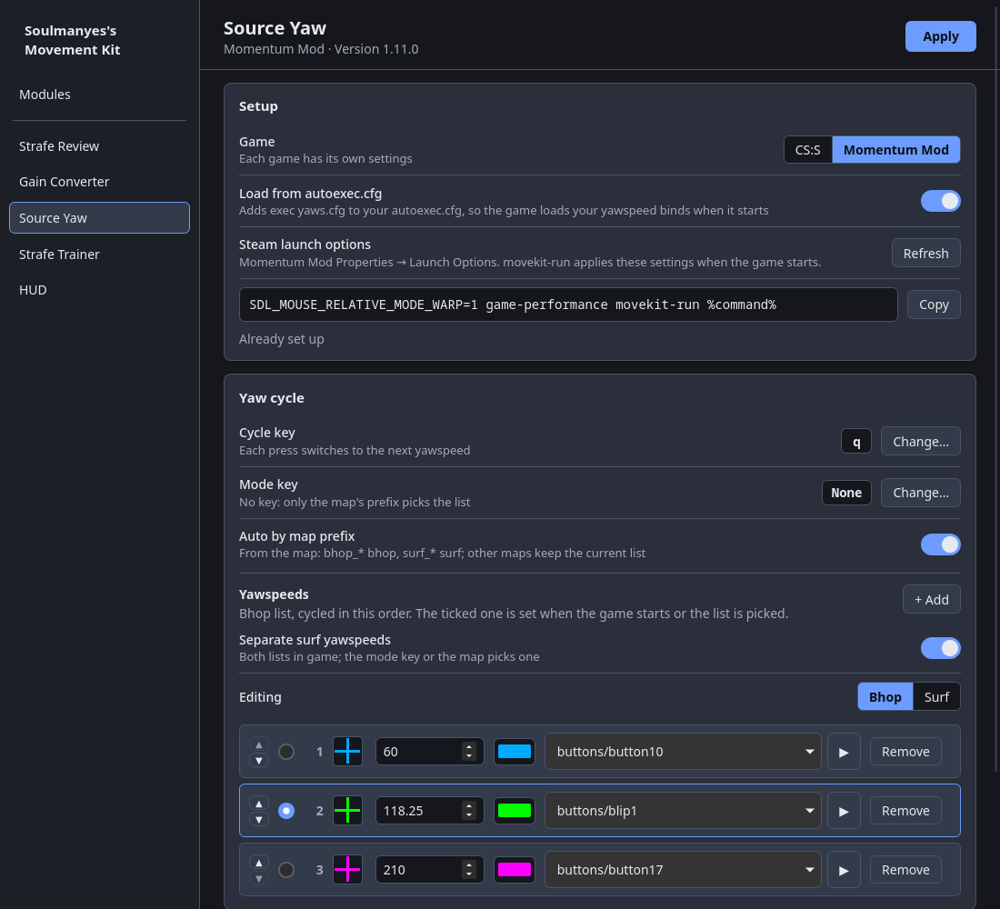
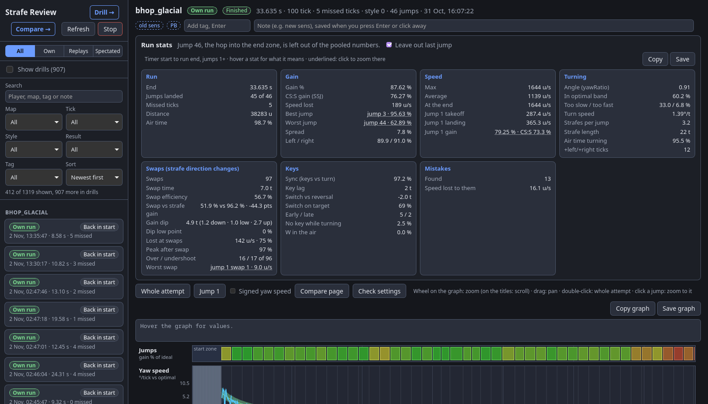
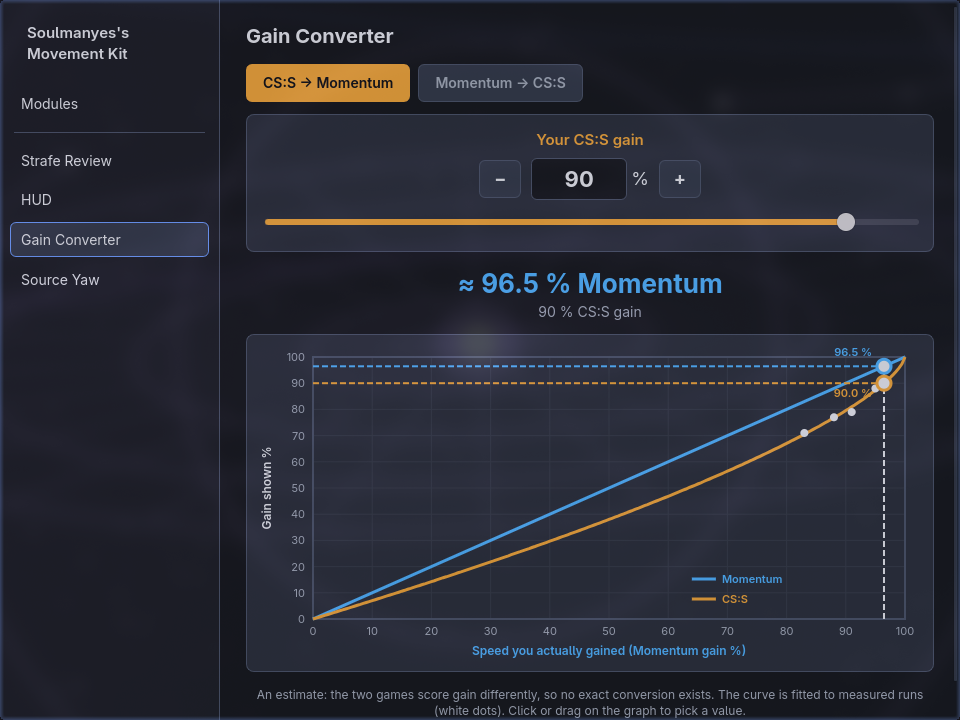

# Soulmanyes's Movement Kit

Standalone surf, bhop and movement tools for Counter-Strike: Source and [Momentum Mod](https://momentum-mod.org/), in one repo with shared code.

| Tool | What it does | Runs on |
| --- | --- | --- |
| [Source Yaw](sourceyaw/) | Cycles `cl_yawspeed` with one key, colours the crosshair per yawspeed, trains strafes | Linux |
| [Strafe Review](strafe-review/) | Records every attempt per tick and reviews it in the browser | Windows, Linux |
| [Gain Converter](gain-converter/) | Converts CS:S SSJ gain % to Momentum gain % and back | Windows, Linux |

Each tool's folder has its own README with what it needs, how to install it and how it works.

| Source Yaw | Strafe Review | Gain Converter |
| --- | --- | --- |
|  |  |  |

## Layout

```
movekit/          the shared Python package (standard library only)
sourceyaw/        Source Yaw
strafe-review/    Strafe Review
gain-converter/   Gain Converter
hud/              in-game display settings, shared by the tools that draw in game (hub section)
.github/          the Windows build and release, shared by the tools that ship an exe
```

`movekit` holds what the tools used to copy between them: Steam and game discovery, autoexec cfg blocks, VPK reading, bind and alias parsing, and the GitHub release updater. It also has the game session (`session.py`), the launch wrapper (`movekit-run`) and a reader for Strafe Review's saved attempts (`attempts.py`, format in [strafe-review/FORMAT.md](strafe-review/FORMAT.md)). A tool imports it from the repo root; an installed or built copy carries its own `movekit` next to it.

`movekit/hub.py` is the start of the hub, one settings window with a section per tool. Strafe Review (status, updates and Open review), the HUD settings (`hud/`) and Gain Converter have sections so far. It is the one part of `movekit` that needs a package outside the standard library: [pywebview](https://pywebview.flowrl.com/) (`python-pywebview` on Arch).

## Launch option (Linux)

One Steam launch option starts every tool that needs to run beside the game: put `movekit-run` right before `%command%`, for example

```
movekit-run %command%
```

Each tool's installer registers its part with it (a launch hook, linked into `~/.local/share/movekit/hooks`) and links `movekit-run` into `~/.local/bin`. Tools that don't fit the game skip themselves: Strafe Review only runs for Momentum Mod. To turn a tool off for one game, list the ones you want in `~/.config/movekit/settings.toml`; a game it leaves out runs every installed tool:

```toml
[launch]
momentum = ["strafe-review", "sourceyaw"]
css = ["sourceyaw"]
```

The older per-tool options still work and start only their own tool: `sourceyaw-run %command%`, `strafe-review-run sourceyaw-run %command%`. On Windows, Strafe Review's exe is its own launch option, as before.

## Releases

Each tool keeps its own version and its own tags: `sourceyaw-v1.6.0`, `strafe-review-v1.5.0`, `gain-converter-v1.1.0`. A tool's updater only looks at releases with its own prefix. A pushed `strafe-review-v*` or `gain-converter-v*` tag builds the Windows exe on GitHub and attaches it to that release. Source Yaw releases are source archives.

The tools used to live in their own repos (`Soulmanyes/sourceyaw`, `Soulmanyes/strafe-review`, `Soulmanyes/gain-converter`), and their history and tags came along. Each old repo's last release points its tool's updater here.

## Licence

CC0 1.0 (see [LICENSE](LICENSE)), except `sourceyaw/overlay/`, which is GPL-3.0 (see [its LICENSE](sourceyaw/overlay/LICENSE)) and includes the Vulkan headers and stb_image under their own licences. The Windows exes also bundle Python and other parts under their own licences; each tool's `THIRD-PARTY-NOTICES.txt` lists them.
