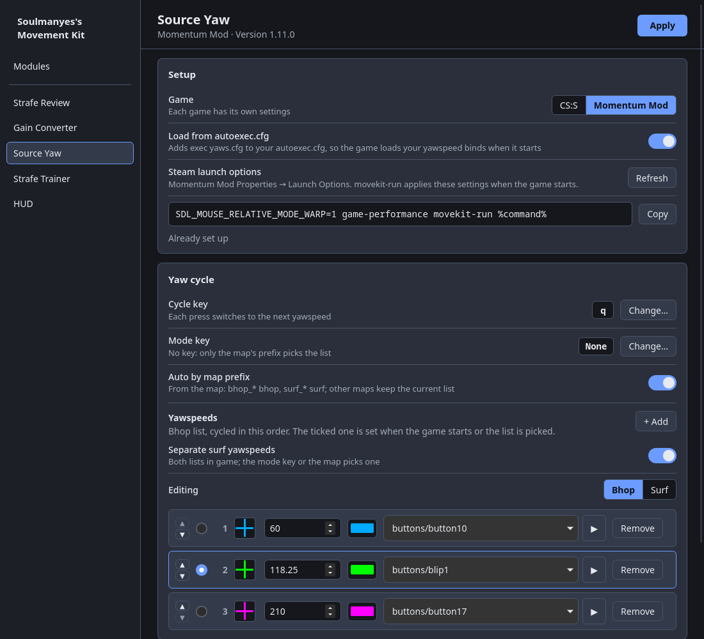

# Source Yaw

*Formerly CS:S Yaw. If you had it installed, the installer moves your settings, and launch
options that still say `css-yaw-run` keep working.*

A surf and bhop helper for Counter-Strike: Source and Momentum Mod on Linux and Windows. It
cycles `cl_yawspeed` with one key and tells you which yawspeed is active. On Windows the crosshair
colour works in Momentum Mod but not in CS:S; see [On Windows](#on-windows).

- **Yawspeed cycle:** one key steps through your yawspeeds. A short game sound plays when
  you switch, and only you hear it.
- **Bhop and surf lists** (optional): separate yawspeeds for bhop and surf. The map's name
  picks the list, and a mode key switches by hand.
- **Yawspeed profiles** (optional): more than one set of yawspeeds per list, say one for kz
  maps. Switch with a console command, or let the map's name pick one.
- **Crosshair colour:** your crosshair changes colour for each yawspeed. In Momentum Mod
  that's the game's own crosshair, on Linux and Windows. CS:S has no crosshair without a weapon,
  so there it's a [KROSSHAIR](https://github.com/noahlyk/krosshair) crosshair, on Linux only.
- **Strafe trainer:** moved to its own module, [Strafe Trainer](../strafe-trainer/), in 1.11.0.
  If you had the trainer on, updating Source Yaw installs it, with your trainer settings copied
  over. Otherwise install it from its card on the Modules page.
- **Settings in the hub:** its settings are a section of
  [Soulmanyes's Movement Kit](../README.md), whose Modules page also installs its updates.

https://github.com/user-attachments/assets/40f99c9d-ba8a-4a52-8c9c-d5cf06575f16



## What you need

On Windows, only the hub: see [On Windows](#on-windows). On Linux:

- Linux, and the native Linux version of CS:S or Momentum Mod on Steam. Steam from your
  distro's packages works. Flatpak Steam doesn't, because `movekit-run` can't run inside
  its sandbox.
- Python 3 and Pillow. `install.sh` installs them with pacman, apt or dnf if they are missing.
- [Soulmanyes's Movement Kit](../README.md#install) for the settings. Its installer brings what
  its window needs.
- For the crosshair colours in CS:S: KROSSHAIR. If it isn't installed, the app can install
  it for you (see below). crosshair-maker is optional. Momentum Mod needs neither.

Tested on CachyOS (Arch), Debian 12 and Ubuntu 22.04, so newer releases of these and
distros based on them (Mint 21 and newer, Pop!_OS, Manjaro, EndeavourOS) should work too.
Fedora and openSUSE Tumbleweed have new enough packages but are untested. On openSUSE,
install the dependencies yourself.

## Install

Two ways, and they end up the same:

- **In the hub:** install [Soulmanyes's Movement Kit](../README.md#install) and click **Install**
  on the Source Yaw card of its Modules page. The card runs the same `install.sh`, but it has no
  terminal to ask for your password: if Python or Pillow is missing, it stops
  with an error. Install them (or run `install.sh` once in a terminal), then press Install again.
- **On its own:**

  ```sh
  curl -fsSL https://raw.githubusercontent.com/Soulmanyes/movement-kit/main/sourceyaw/install.sh | sh
  ```

  It installs the latest release. Or clone the repository and run `./install.sh` from it. Run the
  same command again to update. The settings still open in the hub, so install it too: the first
  time it starts, it takes this copy over as its Source Yaw module, and its Modules page updates
  it from then on.

Then:

1. Open **Source Yaw** (from the app menu, or `sourceyaw`); it opens the hub on Source Yaw's
   section. If you have both games, pick one at the top; each has its own
   settings. Pick your key, yawspeeds, colours and sounds, and press **Apply**.
2. Turn on **Load from autoexec.cfg**, or add `exec yaws.cfg` to your `autoexec.cfg` yourself.

That's all Momentum Mod needs. For CS:S's crosshair colours, also:

3. Add `movekit-run` right before `%command%` in the CS:S launch options. The app shows
   your current launch options with it added, ready to copy. With no other options:

   ```
   movekit-run %command%
   ```

   If Steam can't find `movekit-run` (it lives in `~/.local/bin`), the app shows the full
   path instead. `movekit-run` is the launch option all of the movement tools share: it
   starts each one that is installed (see the repository's README to turn one off per game).
   `sourceyaw-run`, its name before, still works and starts only Source Yaw (and Strafe
   Trainer, which was part of it until 1.11.0).

To remove the app, press **Uninstall** on its card in the hub, or run the install command with
`--uninstall`. Then take `movekit-run` (or `sourceyaw-run`) out of the launch options, unless
another movement tool still uses it:

```sh
curl -fsSL https://raw.githubusercontent.com/Soulmanyes/movement-kit/main/sourceyaw/install.sh | sh -s -- --uninstall
# or, from a clone:
./install.sh --uninstall
```

The command asks whether to remove `yaws.cfg` and its `autoexec.cfg` line too; the card always
removes them, and keeps your settings unless you tick **Also delete saved data**.

## On Windows

1. Install [Soulmanyes's Movement Kit](../README.md#install) and click **Install** on the Source
   Yaw card of its Modules page. Nothing else is needed: no Python, no service, no admin.
2. Open **Source Yaw** in the hub, pick your key, yawspeeds and sounds, and press **Apply**.
   Turn on **Load from autoexec.cfg**.
3. Put the hub before `%command%` in the game's launch options, as the Setup card shows:
   `"C:\full\path\to\movement-kit.exe" %command%`. That one launch option starts every
   installed tool. It rewrites `yaws.cfg` from your settings, and starts the list switcher
   while the game runs.

What's different from Linux:

- In Momentum Mod the yawspeed rows have no crosshair preview, only the colour.
- In CS:S there's no crosshair colour: KROSSHAIR only exists on Linux. The Crosshair card is
  hidden for CS:S.
- Settings are in `%APPDATA%\sourceyaw`, and what the launch did goes to `run.log` there. If
  something doesn't work, `run.log` says why.

If you already had a `yaws.cfg` of your own, the app saves it as `yaws.cfg.bak-sourceyaw`
before writing its own, and uninstalling puts it back.

## Settings

- **Cycle key:** press any key, mouse button or wheel direction to bind it. If that key is
  already bound to something else, the app tells you what.
- **Yawspeeds:** add, remove or drag them into order. Each one has a crosshair colour and a
  sound, which you can preview from the dropdown. The ticked one is set when the game starts.
- **Bhop and surf lists** (the first switch on the card):
  - Off: one list of its own for every map, with no tabs. The bhop and surf lists stay saved
    for when you turn it on again. Its profile is named `main` until you rename it. Settings
    from before 1.15.0 start the one list as a copy of the list that was in game.
  - On: a bhop list and a surf list, both in game, and the **Bhop** and **Surf** tabs pick
    which one you edit. The game starts, and the main menu stays, on the list you last played
    (the bhop list the first time), and the hub opens on that list's tab. Turning it off and on
    again keeps the one list as it was.
  - **Mode key:** each press switches to the other list's ticked yawspeed.
  - **Bhop or surf by map prefix:** on a `bhop_` map the bhop list is used, on a `surf_` map the surf list.
    In Momentum Mod the switch happens as the map loads: the list's ticked yawspeed is set (with
    its colour and sound), and your next press goes to the one after it. **Switch when the map
    loads** (on by default) turns that off, so the switch waits for your first press as in CS:S,
    and **Sound on a map-load switch** (on by default) can mute it. In CS:S it happens on
    your first press of the cycle key after the map loads: that press sets the list's ticked
    yawspeed. Other maps keep the list you're on. Needs `movekit-run` in the launch options.
- **Profile by map:** on, a profile switches in on its maps (**Profile maps** below), and the
  list's other maps use its picked profile. Off, the maps are kept but not used: the profile picked
  with **Use in game**, or its console command, stays. Separate from **Bhop or surf by map
  prefix**, which only picks the list. Settings from before it start with it on when a profile has
  maps.
- **Profile** (per list): each list can hold more than one set of yawspeeds. **New** copies the
  profile shown, **Delete** removes it, and **Use in game** (shown with **Profile by map** off)
  makes it the one the game starts on (and the one the mode key or a map's list goes to, until
  you pick another).
  - **Profile name:** lowercase letters, digits and `_`. Type `yawset_<name>` in the console to
    switch to that profile's ticked yawspeed. That works for a profile of either list, and the
    cycle key and mode key then stay on that profile.
  - **New for this map** (shown with **Profile by map** on) makes a copy of the open profile named after the map you're on (or the
    last one you played), with that map in its maps, in the map's list.
  - **Profile maps** (shown with **Profile by map** on): map names or prefixes, comma separated
    (`kz_, bhop_kz_`). Your first press
    of the cycle key on such a map switches to the profile. In Momentum Mod with **Switch when the
    map loads** on, the profile switches as the map loads instead, on its start yawspeed. That
    works with one list too: the card shows **Switch when the map loads** and **Sound on a
    map-load switch** then without bhop or surf by prefix. A
    profile's maps only count on maps of its own list (by the map prefixes): on a `surf_` map only
    the mode key gets you the bhop list. The longest matching prefix wins. The next map that names
    no profile goes back to the profile in game. Other than that, a profile you pick with
    `yawset_` stays across maps. Apply takes effect at once in Momentum Mod, on your next press
    of the cycle key in CS:S; no restart. Needs `movekit-run` in the launch options.
  - In CS:S each yawspeed has one crosshair image, so a yawspeed in two profiles needs the same
    colour in both.
- **Change crosshair colour:** turn the colour changing off if you only want the sounds.
  In Momentum Mod, turning it off puts your own crosshair colour back.
- **Crosshair** (CS:S): the image that gets recoloured. Choose your crosshair-maker crosshair if
  you use it, the built-in plain cross, or any PNG. The crosshairs that come with KROSSHAIR
  are offered in the file picker.
- **KROSSHAIR** (CS:S): if it isn't installed, **Install** downloads KROSSHAIR 0.2.5 (GPL-3.0,
  x86_64 only) from its GitHub releases into your user folder. No password is needed, and
  nothing is downloaded unless you press it.
- **Updates:** the Source Yaw card on the hub's Modules page shows new releases, with **Update**,
  an auto-update switch and roll back. Source Yaw's own window and its update banner retired in
  Movement Kit 3.8; a copy that still has the old window turns into the launcher at its next
  update.

If the game is already running when you press Apply:

- **Momentum Mod**, started with `movekit-run`: Apply runs `exec yaws` in the game for you
  ("Saved and loaded in the open game"). You land on the ticked yawspeed, or on a profile map on
  that profile's.
- **CS:S**, or Momentum started another way: your next press of the cycle key loads the new
  settings, when auto or profile maps are on. That press lands on the yawspeed after the ticked
  one. Otherwise run `exec yaws` in the console.

## How it works

- The app writes `cfg/yaws.cfg`. In it, each press sets the next `cl_yawspeed` and plays its
  sound with `play`.
- **Momentum Mod:** each press also runs a small cfg in `cfg/yaws_colors/` that sets
  `cl_crosshair_color` to that yawspeed's colour.
- **CS:S:** each press also runs `echo YAW_<speed>`, and `con_logfile yaw.log` copies the
  console to a file. `movekit-run` wraps the game. It rebuilds `yaws.cfg` and the coloured crosshairs from
  your settings, then starts the game with `KROSSHAIR=1` and
  `KROSSHAIR_IMG=~/.config/sourceyaw/current.png`. While the game runs, it watches
  `yaw.log` and copies the matching colour over that file on each `YAW_<speed>` line.
  KROSSHAIR reloads the file whenever it changes.

- **Apply in a running Momentum Mod:** Momentum's engine has a net console, which takes
  console commands over TCP when the game starts with `-netconport` and `-netconpassword`.
  `movekit-run` adds both to the game's command line, so the launch options stay
  `movekit-run %command%`. Each launch gets a free port and a new random password, saved
  owner-only in `~/.config/sourceyaw/netcon-momentum.json` with the launch's process id.
  Apply connects to `127.0.0.1` and sends `exec yaws`, only while that process still runs.
  This is the game's own console, the same as typing the command; nothing touches the game's
  memory. CS:S's engine has no net console, so it keeps the press below. Launch options that set
  `-netconport` themselves are left alone, and Apply then can't send. `mode_watch.py` runs at
  every launch, whatever the settings, so profile maps or auto turned on mid-game work too:
  Apply waits (up to 1.5 s) until it has read the new settings and set the current map's
  profile, then sends `exec yaws`.
- **Bhop and surf lists:** the surf list echoes `YAWSURF_<speed>` and the mode key's alias
  `sourceyaw_mode` echoes `SY_MODE_BHOP` or `SY_MODE_SURF`. With auto on, the cycle key runs
  `exec sourceyaw_auto` before it cycles. That file normally holds only the rerun guard: Apply
  ends `yaws.cfg` with `alias sy_loaded sy_is_<hash>` and writes the guard for that hash, so a press
  while the game still has an older `yaws.cfg` runs `exec yaws` once first. When a map of the other
  list loads, `mode_watch.py` (started by `movekit-run`) writes one line into it, and the next
  press switches the list. It takes the line out again once the game reports the switch.
  Momentum Mod runs `cfg/<gamemode>.cfg` (`surf.cfg`, `bhop.cfg`, ...) itself each time a map of
  that gamemode loads. With auto and the map-load switch on, Apply puts a `// movekit:sourceyaw` block into the ones your map
  prefixes name. It runs `sourceyaw_load_surf` or `sourceyaw_load_bhop`, which switches at once when
  the game is on the other list and does nothing otherwise. Your own lines in those files stay.

- **Profiles:** each profile gets its own `yaw_*` aliases in `yaws.cfg`, and `yawset_<name>` points
  the list's start, cycle and mode-key aliases at it. A profile's tokens are still
  `YAW_<speed>`/`YAWSURF_<speed>`, so the crosshair and the Strafe Trainer work unchanged. For
  profile maps, `mode_watch.py` writes `sourceyaw_arm_set_<id>` into `sourceyaw_auto.cfg` when
  such a map loads, and the next press switches. In Momentum Mod with the map-load switch on, it
  also writes `sy_pstate_<id>; sy_lif_<mode>` into `sourceyaw_mapload.cfg`, which the gamemode
  cfgs exec before their load alias: the map's log line comes before its gamemode cfg runs.
  With one list the block holds only that exec, in every gamemode cfg.
  With both lists in game, `yaws.cfg` ends with `exec sourceyaw_here`, which the switcher keeps on
  the loaded map's list and profile, so running `yaws.cfg` again on a surf map stays on surf. Off
  a map it holds just the last list played (`sy_menu_<list>`, silent), so the menu and the next
  game start use that list. With one list and profile maps `yaws.cfg` execs it too, for the map's
  profile; off a map it's empty. The switcher reads the settings again whenever Apply saves them.

- **Null turnbinds** (off by default): `yaws.cfg` binds the keys `config.cfg` has on `+left`/`+right`
  to `+sy_left`/`+sy_right`. Holding both turn keys turns toward the one pressed last. Letting
  it go turns back to the one still held. Both keys hold `+left`, and the sign of `cl_yawspeed`
  picks the direction: negative turns right. Each key can only let go of its own `+left`,
  because Momentum Mod ties a `-left` to the key that sent it. Once both keys are up, the
  yawspeed is positive again. The turn keys only flip the sign, so a yawspeed you set yourself
  (a `toggle cl_yawspeed` bind, the console) stays as it is. Keys on your own turn aliases (a null script's `+nleft`, say)
  are left as they are; Apply names them. The game saves the nulled binds in `config.cfg`, so
  Source Yaw finds the keys under either name. Turning the option off binds them back to
  `+left`/`+right`, and so does uninstalling.

- **Windows:** the hub exe's launch step (`launch_win.py`) does what `movekit-run` does on
  Linux, with the list switcher as a thread of that process, which ends with the game.

Settings and generated images are stored in `~/.config/sourceyaw` (`%APPDATA%\sourceyaw` on
Windows).

## Limits

- Recolouring is flat: every visible pixel of the crosshair gets the chosen colour, so
  outlines lose their own colour.
- Null turnbinds only see binds in `config.cfg`. A `bind ... +left` in `autoexec.cfg` after
  `exec yaws.cfg` wins over the nulled bind.
- With null turnbinds, a right turn shows as `+left` with a negative `cl_yawspeed`. Replays and
  Strafe Review see it that way too.
- With null turnbinds, a yawspeed you set yourself while holding the right turn key is flipped
  when you let go, so both keys turn the other way. Set it again (or press the cycle key) to fix it.
- If another config changes `cl_yawspeed` directly, the colour isn't updated until the
  next press of the cycle key.
- Momentum's net console listens on all network addresses, not only this PC's. The random
  password is what keeps others on your network out. Windows Firewall may ask about it the first
  time.

## License

[CC0 1.0](LICENSE). Public domain, do what you like. Source Yaw plays sounds straight from
your own game install, and KROSSHAIR is only downloaded from its own releases if you ask for
it. The only other connection is the hub's update check to GitHub.
