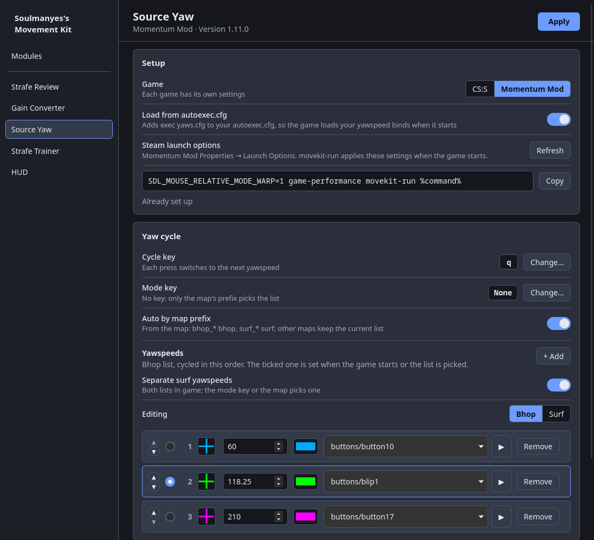

# Source Yaw

*Formerly CS:S Yaw. If you had it installed, the installer moves your settings, and launch
options that still say `css-yaw-run` keep working.*

A surf and bhop helper for Counter-Strike: Source and Momentum Mod on Linux and Windows. It
cycles `cl_yawspeed` with one key and tells you which yawspeed is active. On Windows it does the
yawspeed cycle without the crosshair colour; see [On Windows](#on-windows).

- **Yawspeed cycle:** one key steps through your yawspeeds. A short game sound plays when
  you switch, and only you hear it.
- **Bhop and surf lists** (optional): separate yawspeeds for bhop and surf. The map's name
  picks the list, and a mode key switches by hand.
- **Crosshair colour** (Linux): your crosshair changes colour for each yawspeed. In Momentum Mod
  that's the game's own crosshair. CS:S has no crosshair without a weapon, so there it's a
  [KROSSHAIR](https://github.com/noahlyk/krosshair) crosshair.
- **Strafe trainer:** moved to its own module, [Strafe Trainer](../strafe-trainer/), in 1.11.0.
  Updating Source Yaw installs it, with your trainer settings copied over.
- **Settings in the hub:** its settings are a section of
  [Soulmanyes's Movement Kit](../README.md), whose Modules page also installs its updates.

https://github.com/user-attachments/assets/40f99c9d-ba8a-4a52-8c9c-d5cf06575f16



## What you need

On Windows, only the hub: see [On Windows](#on-windows). On Linux:

- Linux, and the native Linux version of CS:S or Momentum Mod on Steam. Steam from your
  distro's packages works. Flatpak Steam doesn't, because `movekit-run` can't run inside
  its sandbox.
- Python 3 and Pillow. `install.sh` installs them with pacman, apt or dnf if they are missing.
- [Soulmanyes's Movement Kit](../README.md#install) for the settings. Its installer brings what
  its window needs.
- For the crosshair colours in CS:S: KROSSHAIR. If it isn't installed, the app can install
  it for you (see below). crosshair-maker is optional. Momentum Mod needs neither.

Tested on CachyOS (Arch), Debian 12 and Ubuntu 22.04, so newer releases of these and
distros based on them (Mint 21 and newer, Pop!_OS, Manjaro, EndeavourOS) should work too.
Fedora and openSUSE Tumbleweed have new enough packages but are untested. On openSUSE,
install the dependencies yourself.

## Install

Two ways, and they end up the same:

- **In the hub:** install [Soulmanyes's Movement Kit](../README.md#install) and click **Install**
  on the Source Yaw card of its Modules page. The card runs the same `install.sh`, but it has no
  terminal to ask for your password: if Python or Pillow is missing, it stops
  with an error. Install them (or run `install.sh` once in a terminal), then press Install again.
- **On its own:**

  ```sh
  curl -fsSL https://raw.githubusercontent.com/Soulmanyes/movement-kit/main/sourceyaw/install.sh | sh
  ```

  It installs the latest release. Or clone the repository and run `./install.sh` from it. Run the
  same command again to update. The settings still open in the hub, so install it too: the first
  time it starts, it takes this copy over as its Source Yaw module, and its Modules page updates
  it from then on.

Then:

1. Open **Source Yaw** (from the app menu, or `sourceyaw`); it opens the hub on Source Yaw's
   section. If you have both games, pick one at the top; each has its own
   settings. Pick your key, yawspeeds, colours and sounds, and press **Apply**.
2. Turn on **Load from autoexec.cfg**, or add `exec yaws.cfg` to your `autoexec.cfg` yourself.

That's all Momentum Mod needs. For CS:S's crosshair colours, also:

3. Add `movekit-run` right before `%command%` in the CS:S launch options. The app shows
   your current launch options with it added, ready to copy. With no other options:

   ```
   movekit-run %command%
   ```

   If Steam can't find `movekit-run` (it lives in `~/.local/bin`), the app shows the full
   path instead. `movekit-run` is the launch option all of the movement tools share: it
   starts each one that is installed (see the repository's README to turn one off per game).
   `sourceyaw-run`, its name before, still works and starts only Source Yaw.

To remove the app, press **Uninstall** on its card in the hub, or run the install command with
`--uninstall`. Then take `movekit-run` (or `sourceyaw-run`) out of the launch options, unless
another movement tool still uses it:

```sh
curl -fsSL https://raw.githubusercontent.com/Soulmanyes/movement-kit/main/sourceyaw/install.sh | sh -s -- --uninstall
# or, from a clone:
./install.sh --uninstall
```

The command asks whether to remove `yaws.cfg` and its `autoexec.cfg` line too; the card always
removes them, and keeps your settings unless you tick **Also delete saved data**.

## On Windows

1. Install [Soulmanyes's Movement Kit](../README.md#install) and click **Install** on the Source
   Yaw card of its Modules page. Nothing else is needed: no Python, no service, no admin.
2. Open **Source Yaw** in the hub, pick your key, yawspeeds and sounds, and press **Apply**.
   Turn on **Load from autoexec.cfg**.
3. Put the hub before `%command%` in the game's launch options, as the Setup card shows:
   `"C:\full\path\to\movement-kit.exe" %command%`. That one launch option starts every
   installed tool. It rewrites `yaws.cfg` from your settings, and starts the list switcher
   while the game runs.

What's different from Linux:

- No crosshair colour, in either game. The Crosshair card is hidden.
- Settings are in `%APPDATA%\sourceyaw`, and what the launch did goes to `run.log` there. If
  something doesn't work, `run.log` says why.

If you already had a `yaws.cfg` of your own, the app saves it as `yaws.cfg.bak-sourceyaw`
before writing its own, and uninstalling puts it back.

## Settings

- **Cycle key:** press any key, mouse button or wheel direction to bind it. If that key is
  already bound to something else, the app tells you what.
- **Yawspeeds:** add, remove or drag them into order. Each one has a crosshair colour and a
  sound, which you can preview from the dropdown. The ticked one is set when the game starts.
- **Bhop and Surf tabs:** two saved lists. The tabs pick which list you edit.
  - With **Separate surf yawspeeds** off, the game uses one list. The other is greyed out but
    stays saved, and **Use … instead** swaps which one the game uses.
  - With it on, both lists are in game, and the game starts on the bhop list.
  - **Mode key:** each press switches to the other list's ticked yawspeed.
  - **Auto by map prefix:** on a `bhop_` map the bhop list is used, on a `surf_` map the surf list.
    The switch happens on your first press of the cycle key after the map loads: that press
    sets the list's ticked yawspeed. Other maps keep the list you're on. Needs `movekit-run` in
    the launch options.
- **Change crosshair colour:** turn the colour changing off if you only want the sounds.
  In Momentum Mod, turning it off puts your own crosshair colour back.
- **Crosshair** (CS:S): the image that gets recoloured. Choose your crosshair-maker crosshair if
  you use it, the built-in plain cross, or any PNG. The crosshairs that come with KROSSHAIR
  are offered in the file picker.
- **KROSSHAIR** (CS:S): if it isn't installed, **Install** downloads KROSSHAIR 0.2.5 (GPL-3.0,
  x86_64 only) from its GitHub releases into your user folder. No password is needed, and
  nothing is downloaded unless you press it.
- **Updates:** the Source Yaw card on the hub's Modules page shows new releases, with **Update**,
  an auto-update switch and roll back. Source Yaw's own window and its update banner retired in
  Movement Kit 3.8; a copy that still has the old window turns into the launcher at its next
  update.

If the game is already running when you press Apply, run `exec yaws` in the console.

## How it works

- The app writes `cfg/yaws.cfg`. In it, each press sets the next `cl_yawspeed` and plays its
  sound with `play`.
- **Momentum Mod:** each press also runs a small cfg in `cfg/yaws_colors/` that sets
  `cl_crosshair_color` to that yawspeed's colour.
- **CS:S:** each press also runs `echo YAW_<speed>`, and `con_logfile yaw.log` copies the
  console to a file. `movekit-run` wraps the game. It rebuilds `yaws.cfg` and the coloured crosshairs from
  your settings, then starts the game with `KROSSHAIR=1` and
  `KROSSHAIR_IMG=~/.config/sourceyaw/current.png`. While the game runs, it watches
  `yaw.log` and copies the matching colour over that file on each `YAW_<speed>` line.
  KROSSHAIR reloads the file whenever it changes.

- **Bhop and surf lists:** the surf list echoes `YAWSURF_<speed>` and the mode key's alias
  `sourceyaw_mode` echoes `SY_MODE_BHOP` or `SY_MODE_SURF`. With auto on, the cycle key runs
  `exec sourceyaw_auto` before it cycles. That file is normally empty. When a map of the other
  list loads, `mode_watch.py` (started by `movekit-run`) writes one line into it, and the next
  press switches the list. It empties the file again once the game reports the switch.

- **Windows:** the hub exe's launch step (`launch_win.py`) does what `movekit-run` does on
  Linux, with the list switcher as a thread of that process, which ends with the game.

Settings and generated images are stored in `~/.config/sourceyaw` (`%APPDATA%\sourceyaw` on
Windows).

## Limits

- Recolouring is flat: every visible pixel of the crosshair gets the chosen colour, so
  outlines lose their own colour.
- If another config changes `cl_yawspeed` directly, the colour isn't updated until the
  next press of the cycle key.

## License

[CC0 1.0](LICENSE). Public domain, do what you like. Source Yaw plays sounds straight from
your own game install, and KROSSHAIR is only downloaded from its own releases if you ask for
it. The only other connection is the hub's update check to GitHub.
