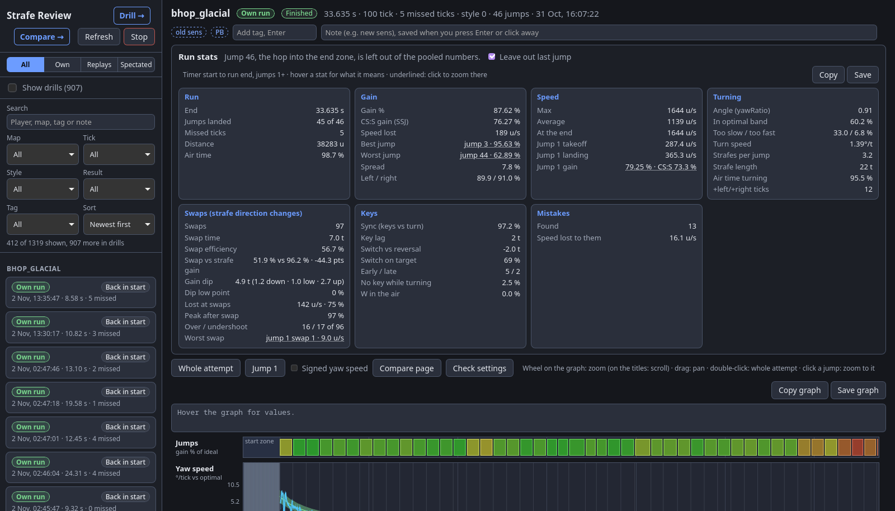

# Strafe Review

Per-tick strafe recording and review for [Momentum Mod](https://momentum-mod.org/). A small HUD script records every attempt, and a page in your browser shows each jump as a graph, lists the mistakes it finds, and compares your strafing with optimal movement and with replays.

The review page has three parts:

- `/`: one attempt as a zoomable graph, with run stats (including CS:S-style SSJ gain; a finished run can leave its last hop into the end zone out of them), the mistakes found and a top-down path. Attempts take notes and tags; automatic tags mark PBs and sens changes. The list filters by whose recording it is (own, replay, spectated) with one click, and by map, tickrate, style, result and tag. It has a search box and sorts by date, fastest finish, jump 1 speed or player. "Compare page" opens it on /compare.
- `/drill`: jump 1 of every attempt, stacked and side by side, updated live, with each strafe's mouse movement in cm next to the optimal (type your mouse DPI in once).
- `/compare`: 2 to 4 recordings on one graph, with every run stat side by side (best per row marked), per jump numbers, mistakes and paths. The picker has the same search, sort and own/replay/spectated buttons. Quick picks: your fastest finish, your best jump 1, top replay.

In game, the recorder can show a line after jump 1 lands: landing speed, gain % per strafe, what lost each strafe the most gain (wrong or no key, turning too slow, or too fast, with a tick count) and the biggest mistake (off by default, see below).

Replays played to the end count as finishes (see [Replays](#replays)). Bonus tracks are recorded and listed per bonus ("surf_artois: b1"), and 66-tick bhop works next to 66-tick surf.

Run stats, graphs and paths on `/` and `/compare` each have Copy and Save buttons: Copy puts a picture of that section on the clipboard, Save downloads it as a PNG.

Everything stays on your PC: the page runs at http://127.0.0.1:8765/ and asks the internet for nothing. Updates come through the kit's hub.

## Replays

Play any replay in Momentum (your own or someone else's) and it is recorded like a run. A replay doesn't carry the game's per-tick gain stats, so gain and angle are worked out from speed; on your own run and its replay they come out the same.

- **Missed ticks are filled from the replay.** The recorder reads the game once per frame, so a frame that takes longer than a tick loses that tick. When a replay sits paused at its end (where it stops by itself), the recorder steps the paused replay back to each tick it missed, reads it, and returns to the end. The view jumps around for a moment, then a note at the top of the screen says the replay was saved and how many missed ticks were filled. Leave the replay paused at the end until the note shows; a replay you leave earlier keeps its missed ticks. This is the only time it controls the game, and only the replay's playback.
- **View angles.** A replay plays its view angles back about 60 ms late (its speed and keys are on time), and the page moves them back. On every tick with a strafe key held, the yaw is taken from the game's own wish velocity, which gives the exact angle the movement used, on live runs as well as replays. The few ticks around a key switch with both or no strafe keys held keep the measured yaw.

## What changed in 1.1.0

Version 1.1.0 changes how recordings are read, so numbers on attempts you already have shift a little when you open them again:

- Yaw speed, Angle and everything worked out from them (strafes, reversals, key timing, mistakes) now use the exact yaw from the wish velocity instead of the per-frame sample. Single-tick spikes in yaw speed get smaller, and some mistakes may appear or go away.
- Replays get the key timing checks, sync and key lag like your own runs (before, their keys were thought to run ahead of the turn; it is the view angles that run late).
- Replays recorded from now on have their missed ticks filled (above). Older replay recordings keep theirs; play the replay to the end once more to record it again.
- Small fixes: switching between a run and a replay no longer moves the graph, the header stays on one row, and graph scales no longer depend on missed ticks.

## Requirements

- Momentum Mod from Steam (the Playtest build works; the game folder is found through Steam's library list).
- [Soulmanyes's Movement Kit](../README.md#install), the hub that installs it: Windows 10 or 11, or Linux with Python 3.10 or newer and a systemd user session.
- A browser.

## Install

1. Install the hub (see the [repository's README](../README.md#install)) and open it.
2. Click **Install** on the Strafe Review card of the Modules page. It finds Momentum (`MOMENTUM_DIR` points it at another folder), installs the recorder and the `autoexec.cfg` block (see below) and registers its launch step.
3. Set Momentum Mod's Steam launch options (Properties > Launch options) to the kit's launch option:
   - Windows: `"C:\full\path\to\movement-kit.exe" %command%`. It starts Strafe Review in the background as the game starts and opens the page.
   - Linux: `movekit-run %command%`, shared with the other tools (see the repository's README). The older `strafe-review-run %command%` still works and starts only Strafe Review. The server runs as the systemd user unit `strafe-review`.
4. Restart Momentum once, so it reads the new `autoexec.cfg` lines.

The server keeps running after the game quits, so the page stays up for review. **Stop** on the page or in the hub's Strafe Review section ends it; **Open review** there starts it again (or before playing, without the launch option).

Attempts are kept in `%LOCALAPPDATA%\strafe-review\attempts` on Windows and `~/.local/share/strafe-review/attempts` on Linux. What the server prints also goes to `strafe-review.log` in the folder above.

**From a clone** of the repository (Linux): `python install.py` in `strafe-review` does what the card's Install does (`--game DIR` for another game folder), and `python viewer/server.py` starts the server by hand (`--port`, `--no-collect` to only serve, `--no-browser`). The hub run from the clone shows the same card and runs the tool in place.

## What it changes in the game folder

- `custom/0-strafe-review`: the recorder script, plus a `timer.xml` that loads it. That file is a copy of the one the game would use otherwise (another HUD mod's in `custom/`, or the game's own) with one line added, made again on every start so other mods' updates carry over. The folder name sorts first because the game mounts `custom/` folders alphabetically and the first file found wins.
- `cfg/autoexec.cfg`: a block between `// movekit:strafe-review begin` and `// movekit:strafe-review end` with `con_logfile yaw.log` (the console log the recorder writes to) and `engine_no_focus_sleep 0` (replays watched while tabbed out keep every tick). The first install keeps the original as `autoexec.cfg.bak-strafe-review`. A block from before 2026-11-02 (`// strafe-review begin`) is replaced where it stands.

**Uninstall** on the card takes them out again (`python install.py --uninstall` from a clone). Your attempts stay unless you tick **Also delete saved data**. If no attempts show up, the main page shows a **Setup check** box that says where it stops.

## Updates and settings

- Updates come from Strafe Review's card on the hub's Modules page: **Update** with **What's new**, **Roll back**, and an auto-update switch that starts off. An update stops the server, swaps the files, reinstalls the recorder and starts the server again. A copy running from a clone is updated by `git pull`: then restart Strafe Review (**Stop**, then start it again with the game or `systemctl --user restart strafe-review`), because a server still running the old code can't serve the new page files, and run `python install.py` again when the recorder changed. Type `panorama_reload` in the game console after a recorder change.
- **Show the jump-1 line in game** in the hub's HUD section turns on the in-game line after jump 1. It is off by default so it doesn't land on top of anyone's own HUD. Type `panorama_reload` in the game console after changing it.

More plans: [PLAN.md](PLAN.md). The saved attempt format, for tools that read attempts: [FORMAT.md](FORMAT.md).

## Thanks

Thanks to Frank for testing the Windows version.

License: CC0 1.0 (see [LICENSE](LICENSE)). The hub's Windows exe, which runs it there, bundles Python and other parts under their own licences; see [hub/THIRD-PARTY-NOTICES.txt](../hub/THIRD-PARTY-NOTICES.txt).
